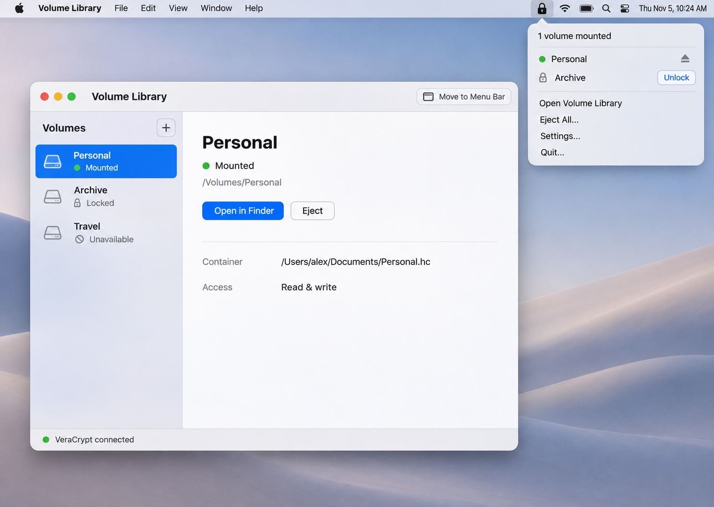
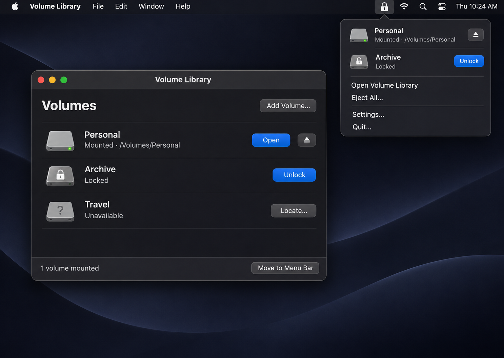
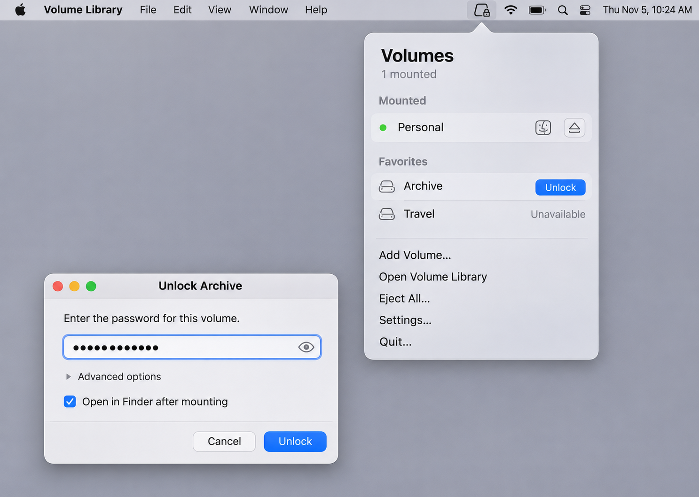

# Native macOS VeraCrypt frontend design

Concept selected 5 November 2026 · Local build verified 10 November 2026

Project directory: `/Users/endogen/Projekte/veracrypt-mac`  
Working interface name: **Volume Library**. Final product name is undecided; the project folder is not a public branding decision.

## Product goal

Build a small native Mac app for opening and ejecting existing VeraCrypt containers, with clear mounted status and persistent access from the macOS menu bar. The installed VeraCrypt executable performs encryption and mounting. Our app owns the interface, saved volume list, and operation coordination.

The first release should make the daily workflow feel like a Mac utility: choose a volume, unlock it, open it in Finder, and eject it when finished. It must remain useful with its main window closed. No account, cloud service, telemetry, or networking is required for the core workflow.

**Implemented direction — Concept 3, Menu Bar First.** The local SwiftUI/AppKit build pairs a 352 × 520 point menu bar popover with a compact library and a separate unlock window. The installed VeraCrypt 1.26.31 FUSE-T build passed a disposable-container read-only mount and eject on this Mac. The remaining sections record the original design targets. The README identifies the features and platform combination in the current build. [Build and usage](README.md)

## Scope

| First release | Later releases |
| --- | --- |
| Register existing file containers with a native file picker or drag and drop | Container creation and formatting |
| Rename, reorder, favorite, locate, and remove saved references | Password changes and header backup or restoration |
| Unlock supported containers and open mounted filesystems in Finder | Device or partition volumes |
| Eject individual managed volumes and eject all managed volumes | Advanced hidden-volume workflows |
| Persistent menu bar controls and optional login launch | Optional Keychain storage after a separate security design |
| Installation checks, actionable failures, and state reconciliation | Bundling or modifying VeraCrypt |
| Read-only mounting and explicit access choices | Scheduled mounting or automatic ejection on sleep |

Removing a saved volume removes only the library reference. The application never deletes the container file. Version one has no force-eject operation and does not automatically mount volumes at login.

Start with normal file containers using the default PIM. Keyfiles and nondefault PIM are capability-gated until the feasibility spike establishes a reliable credential path. A potentially hidden outer volume must not be mounted read/write without verified hidden-volume protection. For the initial restricted release, such volumes are read-only or opened through VeraCrypt. Do not claim to detect whether hidden data exists; users must be able to identify their intended workflow.

## Visual directions

These numbers match the order the images appeared in the design conversation. All directions share the same backend and lifecycle requirements. Light and dark appearances are required regardless of the chosen concept.

| Concept | Structure | Tradeoff |
| --- | --- | --- |
| 1 · Library and Inspector | Saved volumes in a narrow left column; selected volume and actions on the right | More room for paths and advanced settings; larger window |
| 2 · Compact Volume List | One list with status and actions directly in each row | Fast daily use; details need a sheet or disclosure |
| 3 · Menu Bar First | Menu bar popover is the main surface; focused windows handle credentials and library management | Least desktop clutter; more care needed around focus and discoverability |

Concept 3 is selected. The full-window inspector remains an alternative study. The implementation uses a 720 × 520 point library with a 620 × 420 minimum. The following dimensions are implementation targets in macOS points, not measurements inferred from generated pixels.

## Main window layout

For the library direction, use an initial 960 × 640 window with a 760 × 500 minimum. The left volume list is approximately 240–280 points wide; the detail region takes remaining space. Retain system title bar controls and native resizing. Use a single window identity so reopening focuses the existing window.

| Region | Content and behavior |
| --- | --- |
| Toolbar | App title, Add Volume, and Move to Menu Bar in a visible command or overflow menu |
| Volume list | Name, disk symbol, textual state, optional favorite; selected row uses the system highlight |
| Detail header | Volume name, explicit mounted state, and mount location when available |
| Main actions | Locked: Unlock. Mounted: Open in Finder, then Eject. Unavailable: Locate |
| Details | Container location, access mode, and advanced options behind a disclosure |
| Footer | Backend readiness or a recovery action when attention is required |

For Concept 2 use a 720 × 520 initial window, with a minimum of 600 × 400, one scrollable list, 64–76 point rows, and details in a sheet. Concept 3 still provides this compact library window for management; it never requires editing the library inside a crowded popover.

Use native SwiftUI controls, system typography, SF Symbols, semantic system colors, and modest spacing based on 4/8/12/16/24 points. Body text should normally be 13–15 points, with 20–24 point selected-volume headings. Use color alongside words and symbols, never as the only state signal. Avoid custom window chrome, security scores, gauges, and decorative encryption graphics.

Long paths truncate in the middle with a selectable full path in details. File names containing non-Latin text must display correctly. Provide keyboard focus, VoiceOver names for icon buttons, sufficient contrast, and reduced-motion support. Generated Finder/disk icons and material effects are visual suggestions; implementation uses real system assets. Concept 3's highlighted row backgrounds should become normal native rows if they reduce clarity or contrast.

## Menu bar and window lifecycle

On macOS, the requested system tray behavior is a **menu bar extra**. It is persistent app access, not the yellow window minimize button. The implementation uses an AppKit `NSStatusItem` and `NSPopover` hosting the SwiftUI menu. AppKit owns activation and window lifecycle. Apple documents both persistent access and the popover-style window variant. [MenuBarExtra](https://developer.apple.com/documentation/swiftui/menubarextra)

The popover is approximately 340 points wide, with a maximum height near 520 points and scrolling for long lists. Its order is mounted managed volumes, favorite locked volumes, then Open Volume Library, Add Volume, Eject All, Settings, and Quit. Show a mounted count and a last-check warning when state is uncertain. Do not expose paths in the popover unless needed to disambiguate duplicate names. Icon tooltips identify each action and volume.

| User action | Required behavior |
| --- | --- |
| Close the main window with red close or Command-W | Close the window and keep the application in the menu bar; mounts remain unchanged |
| Yellow minimize or Command-M | Preserve standard macOS minimize-to-Dock behavior |
| Move to Menu Bar | Close/hide app windows, preserve the menu bar item, and switch to accessory activation if needed to remove the Dock icon |
| Open Volume Library from menu bar | Restore normal activation, show the Dock icon, focus the library window |
| Unlock from menu bar | Close the popover and present a focused credential window; do not place passwords inside a dismissible popover |
| Disable menu bar presence | Restore a regular Dock app and visible window first; never strand an invisible running app |
| Remove menu bar item through macOS | Observe insertion changes and restore a reachable regular app state |
| Launch at login | If enabled, start in the menu bar without opening volumes or a library window |
| Reopen from Finder or Dock | Focus or recreate the library window |

Default settings: show menu bar item on; keep running after window close on; launch at login off; follow system appearance. Without a menu bar item, closing a window behaves like a regular Mac app with a Dock entry.

Menu bar status uses a monochrome disk symbol with a distinct mounted or attention variation and an accessible label such as “Volume Library, 1 mounted.” A lock icon alone must not imply that every container is locked. The figures use illustrative symbols; this state rule takes precedence.

**Quit is different from hiding.** If there are managed mounts, present “2 volumes are still mounted” with Eject and Quit, Cancel, and a secondary Quit Without Ejecting action. Make clear that the latter leaves files accessible. Eject and Quit processes the target snapshot sequentially and exits only after all target mounts are confirmed absent. If any volume is busy or status cannot be verified, remain running and show the remaining volumes. Unknown or externally managed mounts are listed separately and never silently included in Eject All.

A crash, forced process termination, or shutdown cannot be promised to unmount volumes. Reconcile on the next launch. Automatic ejection on sleep is excluded because its timing and busy-file behavior need separate design.

## Core flows

### First launch

Detect the installed VeraCrypt app and probe its version and supported options. Show Ready, VeraCrypt Missing, Filesystem Support Missing, or Unsupported Version with one appropriate next action. Provide links to official downloads and a Locate VeraCrypt action; do not install or update dependencies automatically. Container mounting remains disabled until prerequisites are usable.

The official downloads currently provide macFUSE and FUSE-T variants, with FUSE-T recommended there for Apple silicon. The installed executable must match its filesystem dependency. Treat the current download recommendation as onboarding guidance, not proof of compatibility on every Mac. [VeraCrypt downloads](https://veracrypt.io/en/Downloads.html)

### Add an existing container

Select a file, choose an optional friendly name, and save its bookmark. Adding does not attempt to mount it and does not prove the file is a valid container. Allow files without a particular extension. Detect duplicate references by resolved file identity where possible; file paths alone are insufficient after moves or renames. An unavailable file offers Locate and Remove from Library.

### Unlock

Show the selected name, secure password field, optional press-and-hold reveal, and an unchecked Open in Finder after mounting preference on first use. The concept image's checked state is illustrative; the product default is off. Advanced options contain access mode and only the credential features supported by the tested backend adapter. Never remember the password by default.

Initially select read-only for a newly added volume. Read/write is an explicit per-volume choice for a normal volume; explain the restriction for outer volumes with hidden data. Persist access preferences only, never credentials. System administrator authorization, when needed, is a separate system-managed step; do not ask for a Mac login password in our volume-password field.

After submission, disable duplicate actions, show indeterminate progress, and verify the resulting mount before reporting success. Never invent percentage progress. If a filesystem did not mount, report that partial outcome instead of offering Open in Finder. A wrong password, PIM, or keyfile may be indistinguishable; copy should say “Couldn’t unlock this volume. Check the password and advanced options.”

### Eject

Eject the chosen verified mount. Confirm absence from a fresh backend snapshot before showing Locked. If busy, keep Mounted and show “Close files using this volume, then try again,” with Retry and Open in Finder. Do not force-unmount or close other applications automatically.

### Empty and failure states

| State | Presentation and recovery |
| --- | --- |
| Empty library | “Add an existing VeraCrypt volume” with Add Volume |
| Missing removable disk or file | Unavailable; Locate or reconnect guidance |
| Permission denied | Specific access guidance, then Retry |
| Authorization cancelled | Return to prior verified state; preserve nonsecret options |
| Mounting or ejecting | Spinner and descriptive verb; duplicate operations disabled |
| Timeout or cancellation | Checking Status until reconciliation completes |
| Backend unavailable or unparseable | Status Unknown, last known state visibly stale; Refresh or dependency recovery |
| Mounted externally | “Mounted outside this app”; observe and Open in Finder; explicit Adopt Management before eject controls |

## Architecture

Use Swift and SwiftUI with small AppKit adapters. Proposed minimum deployment target: macOS 14, simplifying the observation model and window/settings integration. Confirm the user's actual supported OS range before implementation. Plan Apple silicon first, then validate an Intel build if needed. Distribute directly as a signed and notarized app; App Store sandbox distribution is outside the initial scope.

The data flow is: **SwiftUI windows and menu bar → shared application model → volume coordinator → VeraCrypt adapter → installed executable → filesystem integration**. The UI never constructs command arguments or infers success from a button click. The same model feeds every surface.

| Component | Responsibility |
| --- | --- |
| App model | Main-actor observable state shared by library, credential window, settings, and menu bar |
| Volume coordinator | Serialize operations, own state transitions, reconcile snapshots, and manage explicit target sets |
| Backend protocol | Probe capabilities, list mounts, mount, unmount, and return typed results; enables a deterministic fake backend |
| VeraCrypt adapter | Translate typed requests to version-aware command arguments and parse actual CLI output |
| Process runner | Execute a validated absolute binary URL, manage pipes and process lifecycle, limit output, and report exit status |
| Authorization bridge | Encapsulate the verified macOS elevation mechanism; implementation is gated by the initial spike |
| Library store | Versioned local saved-reference data with atomic replacement and recovery from malformed metadata |
| Window coordinator | Handle activation policy, reopening, background mode, and credential-window focus |
| Login item controller | Register or unregister the main app via SMAppService and reflect actual system approval status |

`SMAppService` provides login-item registration and status on macOS 13 and later. Launch-at-login is user controlled and may require approval in System Settings. [Apple SMAppService](https://developer.apple.com/documentation/servicemanagement/smappservice)

Keep these as modules or focused types within one app target initially. Do not add a daemon, separate service, plug-in system, or third-party state framework without a demonstrated need. A privileged helper is a fallback decision, not an assumed requirement.

## Backend contract and credential handling

The existing macOS executable has text mode; `--text` must come first. Documented operations include list, mount, and unmount, with `--non-interactive` and `--stdin` for password input. Command-line secrets may be exposed, and stdin is line-delimited and locale-sensitive. Verify exact behavior against the installed release instead of assuming the website and binary match. [VeraCrypt Unix CLI](https://veracrypt.io/en/Command%20Line%20Usage%20for%20Unix.html)

Use Foundation Process with an explicit executable URL and separate arguments, never shell interpolation. Locate the executable through the selected installed app bundle; do not search an arbitrary PATH or execute a downloaded replacement. Inspect executable identity and record tested releases. Code-signing identity expectations must be established from official installed artifacts rather than guessed identifiers.

Use a private stdin pipe for the volume password, close it after writing, and exclude it from logs, environment variables, command arguments, crash annotations, and persisted state. Do not normalize or trim password text. Establish an explicit tested UTF-8 locale and reject credential forms the transport cannot preserve, including embedded newlines. Clear the UI field and release buffers promptly; do not promise guaranteed zeroization of Swift-managed strings. Password caching is off unless the spike proves a supported way to control and clear it; inherited VeraCrypt settings must not silently change this policy.

Nondefault PIM and hidden-volume protection credentials require separate handling: do not route them through command arguments merely because the CLI accepts those flags. If the installed CLI cannot accept them through a suitably tested channel, disable that workflow and offer Open VeraCrypt. No general-purpose terminal prompt scraping is part of the baseline design.

Drain stdout and stderr concurrently to prevent pipe deadlock. Use bounded capture, output redaction, timeouts appropriate to key derivation, and no automatic retry of a mutation. Parse a pinned locale with fixtures from tested versions; the documented interface is text, not a promised JSON API. A parse failure produces Unknown, never an empty list interpreted as all volumes locked.

Treat cancellation as a request to stop the frontend operation, not evidence that the backend undid it. After process exit, timeout, or cancellation, list mounts again. Do not kill VeraCrypt services or mount processes indiscriminately. Mount identity must include resolved container identity and observed mount/device data; do not act on a stale reused slot alone.

## State and persistence

Persistent metadata includes a stable local ID, display name, file bookmark, favorite/order, access preference, and whether Finder should open after mounting. Store it under the eventual app's Application Support directory. Use local preferences for appearance, menu bar presence, and login launch. No password, PIM, key material, or credential history is persisted. Keyfile bookmarks, if supported later, refer to files and never copy their contents.

Keep mount state separate from saved metadata. Model availability, observed mount status, operation status, and observation freshness independently so “operation failed” cannot erase a still-mounted state. Mounts can be mounted, unmounted, partially attached, or unknown; operations can be idle, unlocking, ejecting, or reconciling.

Reconcile on launch, foreground activation, popover opening, wake, relevant volume events, and after every operation. Proposed polling defaults are five seconds while a surface is visible and thirty seconds in the background only while mounts are managed; measure cost before committing. Avoid concurrent polls and never let an older result overwrite a newer completed operation.

VeraCrypt may also be used externally. Import those observations without assuming ownership. Eject All targets only mounts explicitly managed in the current app session. After restart, previously remembered mounts are observations until verified and adopted; do not restore ownership from a slot number. An explicit Adopt Management action makes the effect clear before granting eject control.

Logs contain operation categories, durations, and redacted error classes by default. Paths and volume names are private metadata and should not enter diagnostic exports without an explicit preview. The frontend cannot protect secrets from a compromised operating system; its responsibility is to avoid unnecessary exposure and misleading mount status.

## Feasibility checks before implementation

Run these against disposable containers, never the user's real data. Capture a supported combination of macOS, architecture, VeraCrypt release, and filesystem integration. The read-only path, including stdin, filesystem mount, status reconciliation, and eject, passed on macOS 27.0.1 with Apple silicon, VeraCrypt 1.26.31, and FUSE-T 1.2.9. Interactive administrator escalation and busy-volume recovery remain outside the live verification.

| Check | Required outcome |
| --- | --- |
| CLI launched from a minimal signed app context | Version/list work without unexpected GUI or terminal dependencies |
| Normal volume mount with stdin | Password reaches the backend correctly, including Unicode and spaces, without visible arguments |
| Administrator authorization | A reliable system prompt and cancellation path, without our app storing administrator credentials |
| Mount and filesystem result | Success is distinguished from partial attachment and mount failure |
| Eject with an open file | Busy result preserves mounted state and supports safe retry |
| External mount and unmount | Snapshot reconciliation detects changes without taking unintended ownership |
| Missing FUSE or incompatible build | Actionable prerequisite error without guessing success |
| Process interruption and backend delay | No false Locked state, duplicate mutation, or orphaned uncontrolled operation |
| Menu bar focus and Dock activation | Close, hide, reopen, settings, and credential prompts remain reachable |

If elevation cannot work reliably through the installed CLI, decide whether to add a minimal authenticated helper. Such a helper would require a separate security design, strict client validation, allowlisted operations and executable identity, and no arbitrary command execution. If that work is disproportionate, reduce supported workflows before promising seamless mounting.

## Delivery sequence and acceptance

1. **Select the visual direction.** Concept 3 was chosen, including its supporting compact library.
2. **Prove the backend.** Complete the disposable-container checks and record the supported version matrix and authorization mechanism.
3. **Build the native shell with a fake backend.** Implement shared state, library, unlock window, settings, and menu bar lifecycle. Exercise errors and accessibility before using real data.
4. **Integrate the CLI.** Connect the version-aware adapter and reconciliation; add real mount/eject flows only for validated capabilities.
5. **Verify and package.** Test lifecycle and busy volumes, then sign, notarize, and exercise installation on a clean account or test machine.

Acceptance requires that a supported normal container can be added, unlocked, opened in Finder, and safely ejected; closing the window keeps menu bar access; Move to Menu Bar removes Dock clutter and reopening restores the window; quit cannot falsely imply successful ejection; and backend failures cannot become false Locked states. Validate keyboard navigation, VoiceOver, long names, light/dark appearance, app relaunch, external unmount, and dependency failure.

Focused automated checks should cover argument safety, password transport boundaries, parser fixtures, operation serialization, stale-result handling, ownership of Eject All targets, and state recovery. Real integration checks use disposable containers and the tested platform matrix. No full UI screenshot test suite is needed for the initial shell.

## Decisions still open

The development build is named Volume Library, targets macOS 14 or later and accepts VeraCrypt 1.26.31. Intel validation, additional VeraCrypt versions, privileged workflows and public distribution remain open. The architectural default is an installed executable dependency with no VeraCrypt source fork, no credential persistence, and no privileged helper unless the feasibility work demonstrates a need.

