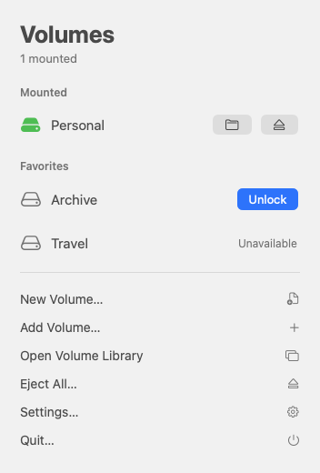
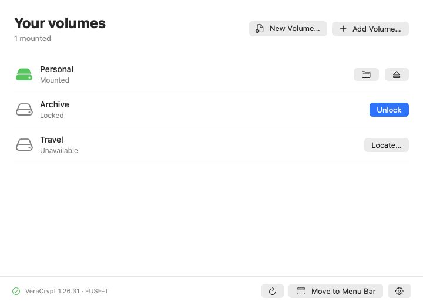
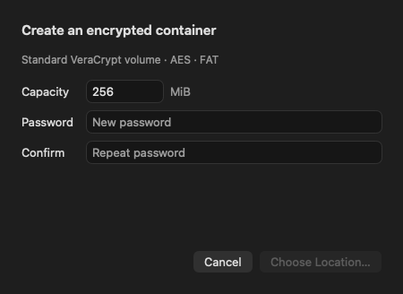

# Volume Library

Create, unlock and eject VeraCrypt containers from the macOS menu bar. Volume Library provides a native SwiftUI interface and opens mounted volumes in Finder. Your installed copy of VeraCrypt handles encryption and disk access.

**[Download the latest release for Apple silicon](https://github.com/Endogen/volume-library/releases/latest)** (ZIP, release notes and checksum) · [Website](https://endogen.github.io/volume-library/)

<table>
<tr><th align="left">In the menu bar</th><th align="left">In the library</th></tr>
<tr><td valign="top"></td><td valign="top"></td></tr>
</table>

Screenshots use sample library entries.

## Install

1. Use an Apple silicon Mac running macOS 14 or later. Version 0.1.0 was tested on macOS 27.0.1 with VeraCrypt **1.26.31** and FUSE-T **1.2.9**. This release accepts that exact VeraCrypt version.
2. Install [FUSE-T](https://www.fuse-t.org/) and the matching **FUSE-T version** of [VeraCrypt for macOS](https://veracrypt.io/en/Downloads.html). Put VeraCrypt in Applications, or use **Settings → Locate…** to select your copy.
3. Download and unzip the release, drag **Volume Library.app** to **Applications**, and open it. Click the lock or drive icon in the menu bar.

The download is signed with an **Apple Development** certificate and has not been notarized. Gatekeeper may block its first launch. Apple explains how to review that alert and allow an individual app you trust. [Apple’s guide to opening downloaded apps](https://support.apple.com/en-us/102445)

To verify the download, put the ZIP and `SHA256SUMS.txt` from the same release in one folder and run:

```sh
shasum -a 256 -c SHA256SUMS.txt
```

## Open an existing container

Choose **Add Volume…** and select your container file. Click **Unlock**, enter the volume password and use the folder button to open it in Finder. The unlock window can also open Finder automatically after mounting.

Newly added volumes default to **read-only**. For write access, open **Advanced options**, turn off **Mount read-only**, and confirm the container is a normal volume with no hidden volume to protect. The wrapper supports passwords with the default PIM. Use VeraCrypt itself for keyfiles, custom PIM, and hidden-volume protection.

## Create a volume

Choose **New Volume…** from the menu bar or library, or press **⌘N**. Set a capacity of at least 5 MiB, enter and confirm a password, then choose a location and filename. The app creates a standard AES-encrypted container with a FAT filesystem and adds it to the library ready to unlock. Creation preserves existing files at the chosen destination.



## Manage volumes

- **Favorites and file references.** Right-click a library row to rename it, change its favorite status, or locate a moved file. Removing a reference keeps the container on disk.
- **Ejection.** Use the eject button when finished. **Eject All** applies to volumes opened here and external mounts you explicitly adopted using **Manage**. Quitting alone can leave files mounted.
- **Menu bar and startup.** **Move to Menu Bar** hides the windows and Dock icon. **Open Volume Library** brings them back. Settings includes launch at login and system, light or dark appearance.
- **Local storage.** Volume Library stores bookmarks, display names, favorites and mount preferences in `~/Library/Application Support/VolumeLibrary/library.json`. It passes the password to VeraCrypt through standard input and does not save it.

If Settings reports a missing filesystem library, check that VeraCrypt and its FUSE driver are a matching pair, then choose **Retry**. If macOS prompts for Command Line Tools, the current build uses Apple's `otool` to identify VeraCrypt's FUSE linkage. For a busy volume, close files using it and retry ejection.

## Build and test

Clone the repository on a Mac with a Swift 6 toolchain and macOS SDK, then run:

```sh
git clone https://github.com/Endogen/volume-library.git
cd volume-library
CONFIGURATION=release ./scripts/build.sh
open 'build/Volume Library.app'
```

The build script produces an ad-hoc-signed app for local use. Run `swift test` for the regular suite. To include the live integration test, install the supported VeraCrypt and FUSE-T builds and run:

```sh
VOLUME_LIBRARY_LIVE_TEST=1 swift test
```

The live test creates a disposable container, writes a file, ejects the volume, remounts it read-only and compares the recovered bytes. It ejects again and removes the fixture.

[Design document](DESIGN.md) · [Implementation log](WORK_LOG.md) · [Report an issue](https://github.com/Endogen/volume-library/issues)

Volume Library is an independent frontend for VeraCrypt. The VeraCrypt app and FUSE-T are installed separately.
