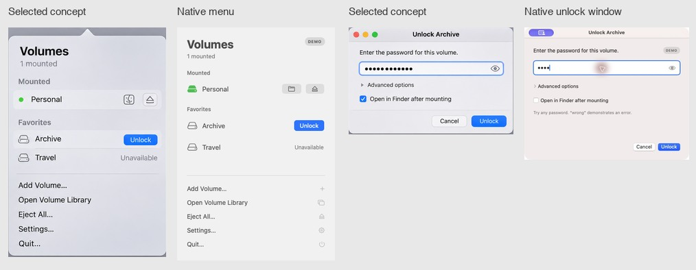

# Concept 3 implementation review

**Final result** — passed

The final native popover preserves the mounted count, Mounted and Favorites groups, inline volume actions and the five utility commands in the selected design. The unlock window preserves the secure field, disclosure, Finder preference and default action. The demo badge and password hint identify simulated data. Newly added volumes start with the Finder preference off.

## Evidence

| Surface | Reference and capture | Comparison |
| --- | --- | --- |
| Full design | [Concept 3](design/03-menu-bar-first.png), 1487 × 1058 px | The concept shows both surfaces together. In use, choosing Unlock dismisses the transient popover and focuses the credential window. |
| Popover | [Light](design/qa/menu-light.png) and [dark](design/qa/menu-dark.png), 352 × 520 px | Captured the hosting view inside a visible AppKit popover in an instrumented native build. The capture excludes the outer arrow and window shadow. The status item remained present in accessory mode. |
| Unlock | [Window](design/qa/unlock-light.jpg), 440 × 354 px | Captured the running app in demo mode. Title and password visibility controls belong to the separate window. Demo help accounts for some of the extra height. |
| Library and settings | [Library](design/qa/library-light.jpg), 720 × 548 px, and [Settings](design/qa/settings-light.jpg), 500 × 498 px | The window captures include title bars. Settings shows the actual connected FUSE-T backend. |

For the comparison sheet, the concept menu crop is 499 × 727 px and the unlock crop is 627 × 408 px. Each source/render pair was resized to the same displayed width, 230 or 240 px respectively, preserving its aspect ratio. Native captures are at one image pixel per point. The live popover uses standard system material and SF Symbols. CSS viewport units do not apply.

## Findings and retest

- **Settings window sizing.** The hosting view initially expanded the window to 859 px high. Explicit window sizing brought it to 498 px including the title bar and kept the actions together.
- **Volume symbols.** Unavailable SF Symbols left gaps in volume rows. The updated library and popover captures show supported drive and eject symbols with accessible action names.
- **Popover appearance.** The first light-mode check produced a dark popover alongside a light unlock window. Applying the appearance to the popover itself produced the two distinct captures above.
- **Menu bar lifecycle.** The app now hides its windows on Move to Menu Bar. An in-process check verified that the library was hidden and the app used accessory activation, the status button opened a visible popover, and reopening the library restored regular activation.

## Interaction coverage

The demo checks exercised unlock errors, success, ejection and quit choices. In live mode the file picker added a disposable container, the unlock window mounted it, the library showed Mounted with Finder and Eject actions, and ejection restored Locked. The test reference was removed and VeraCrypt reported zero remaining mounts. Full VoiceOver navigation, login after a restart and a live read/write mount remain unverified.
